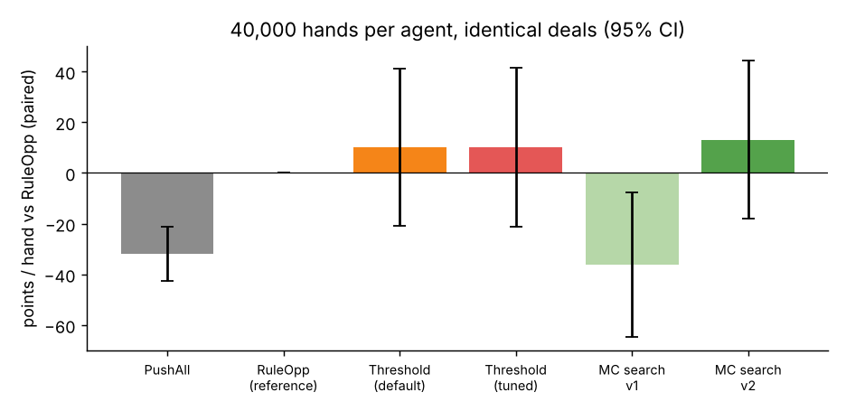

# Rule-based Riichi agent with Monte-Carlo search and opponent modeling

A from-scratch Riichi Mahjong engine and agent that decides when to push or fold by combining Monte Carlo search with an opponent model fitted to simulated data.

**Headline results** (40,000 hands per agent, identical deals, paired comparisons):
- Monte Carlo search (v2) halved the deal-in rate vs. the rule-based baseline
  (15.6% → 7.6%) and had the highest mean score (+13.2 ± 16.0 points/hand paired).
- That score gap is not statistically significant at this sample size; resolving it
  would take roughly 1M hands per agent. The one significant score result:
  never folding (PushAll) costs 31.9 ± 5.4 points/hand.

**Skills:** Python, number, Monte Carlo simulation, maximum-likelihood estimation, probability calibration (AUC, Brier score), held-out validation.

## What was built
| File | Role |
|---|---|
| `engine.py` | Closed-hand Riichi engine (136 tiles, 4 players, riichi, tsumo/ron, furiten, dora/ura, mangan+ scoring, noten payments, riichi sticks). Shanten/ukeire come from per-suit lookup tables compiled with numba (~3 µs per call). |
| `agents.py` | `PushAll`, `RuleOpp` (efficiency + genbutsu fold), `ThresholdAgent` (explicit push/fold thresholds), `MCTSAgent` (search + opponent model), and the learned `DangerModel`. |
| `calibrate.py` | Fits the opponent model from 8,000 simulated hands. |
| `run_eval.py`, `run_*.sh` | Experiment drivers. Seat 0 is the agent under test; seats 1-3 are `RuleOpp` bots with random riichi/dama styles. |
| `analyze.py`, `heldout_calib.py` | Statistics and figures. |

### Opponent model (learned from simulation, not hand-set)
* **Wait model.** P(tile is a winning tile of a riichi'd opponent | tile is not genbutsu). It is a table keyed on tile class, suji state, visible copies and riichi lateness. On 47,692 held-out events it is calibrated (predicted vs observed within about 0.3 pt from 0.2% to 13%) with AUC 0.67 and Brier 0.0624 vs 0.0639 for a flat rate.
* **Hidden-threat model.** P(opponent is dama-tenpai | turn bin), which is 0.1%, 1.1%, 3.8% and 8.6% for the four bins.
* **Race parameters.** Live wait count distribution (mean 4.3), ron multiplier ρ = 2.75, and the per-round hazard of an outside win η = 0.13, fitted by MLE to 12,007 riichi declarations (51% of riichi hands win).

### MCTS-style search (only at "contested" decisions, i.e. someone is in riichi)
* **Arms.** Candidate discard × continuation policy: push-all, push-until-2-shanten, or defend. About 15 arms.
* **Determinization.** Each simulated world samples which opponents really threaten, their wait count, and whether the discarded tile hits. All arms share the same random numbers, so differences are paired.
* **Rollout.** An abstract per-round simulation with my improvement probability u/U, opponent tsumo hazard, deal-in risk per discard, noten payments, and a reduced progress rate γ while defending.
* **Root bandit.** Sequential halving over tiles inside the push group and the defend group. The two finalists are then compared on a fresh paired batch of 1,200 worlds.
* **Uncontested turns** use the efficiency discard with a danger tie-break.

## Results (points per hand for seat 0; 40,000 hands per agent, identical deals, fresh seeds)
| Agent | Mean ± SE | Paired vs RuleOpp | Win % | Deal-in % |
|---|---|---|---|---|
| PushAll (no defense) | −26.5 ± 16.8 | **−31.9 ± 5.4** | 22.5 | 18.6 |
| RuleOpp (genbutsu fold at ≥2-shanten) | 5.4 ± 16.5 | reference | 22.1 | 15.6 |
| Threshold rule (τ = .20/.10/.04) | 15.6 ± 15.3 | +10.2 ± 15.8 | 20.2 | 9.7 |
| Threshold rule (tuned τ = .30/.15/.03) | 15.5 ± 15.8 | +10.1 ± 15.9 | 21.2 | 12.4 |
| MC search v1 | −30.7 ± 14.1 | −36.2 ± 14.5 | 17.8 | 5.9 |
| **MC search v2** | **18.6 ± 14.8** | **+13.2 ± 16.0** | 19.2 | 7.6 |

**Honest reading.**
1. Defense matters, and this is the one statistically solid result: PushAll is 32 ± 5 points per hand worse than every agent that folds.
2. The three defensive agents (RuleOpp, Threshold, MC v2) are **not separable at 40k hands**. The paired SE is about 16 points, so resolving a 10-point gap would take roughly 1M hands per agent. MC v2 has the highest point estimate but is not significantly better.
3. v1 of the search lost to the baselines. Its rollouts ignored noten (tenpai) payments at exhaustive draws and treated defending as a dead hand, so it over-folded at 1-shanten. v2 fixes both and keeps a reduced progress rate γ = 0.35 while defending. On tuning seeds γ ∈ {0.2, 0.35, 0.5} gave 84, 79 and 81 points. The tuning seeds overstate the gain: tuning-seed means were +79 to +84 while the fresh-seed result is +18.6. An earlier identical-config run of v2 gave +26.1 ± 14.8, which shows the run-to-run noise.

## Decision thresholds
**Ground truth from threshold sweeps** (`ThresholdAgent`, 20k hands per point on separate tuning seeds, SE ≈ 22 per point; fold if the efficient discard's P(deal-in) exceeds τ for that shanten):

| Hand state | τ → points/hand | Optimal rule |
|---|---|---|
| Tenpai | 0: **−169**, .05: −113, .10: −57, .20: +21, .30: +26, never fold: +25 | **Push**, folding only above P(deal-in) ≈ 0.2–0.3, which almost never occurs. Folding from tenpai costs up to ~190 points/hand. |
| 1-shanten | 0: −27, .02: +3, .05: +10, .10: +21, **.15: +32**, .25: +30, never fold: +28 | Push through P(deal-in) up to about 0.15; the plateau beyond is within noise. |
| 2+-shanten | 0–.04: +19…+25, .08: +7, .15: −10, never fold: −18 | **Fold above P(deal-in) ≈ 0.04–0.05.** Pushing instead costs ~40 points/hand. |

**What the search does** (120k+ contested decisions). The table shows the share of decisions where the search sacrifices hand progress (shanten gets worse) to play safe.

| State | Danger of efficient discard | Sacrifices progress | Note |
|---|---|---|---|
| 1-shanten | < 1% | 1–9% | |
| 1-shanten | 1–3% | 16–25% | |
| 1-shanten | **3–6%** | **48–54%** | 50% crossover; logistic d50 ≈ 0.078 after controls |
| 1-shanten | 6–10% | 56–67% | |
| 1-shanten | > 20% | ~85% | |
| Tenpai | any | ≈ 4% | Tenpai hands are almost never broken up. |

* The rest of the 1-shanten logistic: higher hand value relative to the loss means less folding (coefficient −1.4 on V/L), more ukeire means less folding (−3.0 per +10 tiles), and more riichi opponents means more folding (+0.3 per opponent). Turns left barely matters, apart from slightly more folding with 1–2 rounds left.
* At 2-shanten the search swaps to a safer tile of equal efficiency 82–98% of the time once danger exceeds 3%. It rarely abandons the hand outright.
* The search's 1-shanten crossover (~0.05) is more conservative than the sweep optimum (~0.15). **The model still under-values pushing at 1-shanten**, which limits its gain. This is the clearest next improvement.

**Under uncertainty.**
* Multiplying danger estimates by lognormal noise (mean-preserving) at σ = 0, 0.25, 0.5, 1.0, 1.5 gives +21.0, +19.6, −0.2, −16.5, −17.2 points/hand. A fixed-threshold agent degrades quickly once errors reach ~50%.
* At σ = 1 the best 1-shanten τ rises to ≥ 0.15 (−8.8 vs −58.8 at τ = 0). When danger estimates are unreliable, the better response is to fold less, not more, because spurious high readings otherwise trigger needless folds.
* **Value of the learned opponent model** (flat danger = genbutsu knowledge only, paired on 20k identical deals):
  * MC search: +38.8 → +4.9, a gain of +33.9 ± 21.1 from the model (about 1.6σ). Deal-in rate 8.8% → 7.5%.
  * Threshold rule: +9.0 ± 20.0 (not significant). Deal-in rate 12.6% → 9.7%.
  * The model clearly reduces deal-ins, but its effect on points is not conclusive at this sample size.

## Caveats
* **Simplified rules:** no calls or kan, no red fives, fixed fu (30/25), limited yaku (no pinfu, iipeikou, sanshoku, ittsu, ippatsu), and a single hand per game (not a full East round). Exhaustive draws are rarer than in real play (about 10%). The objective is expected points, not placement.
* **Opponent realism:** opponents are heuristic bots, and the danger model is learned from games against the same bots, so it is in-distribution. Transfer to human or Mortal-style play is untested.
* **Seed discipline:** calibration seeds ≥ 1,000,000, tuning seeds 100,000+, held-out calibration seeds 2,000,000+ and headline evaluation seeds 0–39,999 never overlap. Only γ and the threshold values were tuned, and only on the tuning seeds.
* **Scale:** about 1M simulated hands in total (8k calibration, 6k held-out, 240k headline, ~600k sweeps, noise and ablations).

## How to run

    pip install -r requirements.txt

    # Fit the opponent model from simulated hands (writes model.pkl; a fitted copy is included)
    python calibrate.py

    # Evaluate one agent in seat 0 against three RuleOpp bots
    # usage: python run_eval.py NAME N_HANDS OUTPUT [key=val ...]
    # NAME is one of: pushall | ruleopp | thresh | mcts
    python run_eval.py mcts 2000 results/demo_mcts.pkl

    # Reproduce the full experiment (40k-hand evaluations, ablations, threshold sweeps)
    bash run_all.sh

    # Statistics and figures
    python analyze.py

The first run compiles numba code, so it is slower. The full experiment takes a long time;
start with the 2,000-hand demo above.
